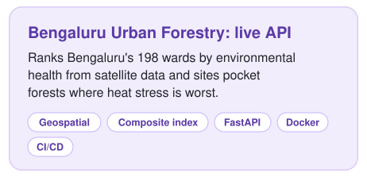
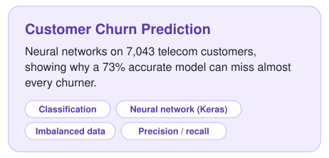
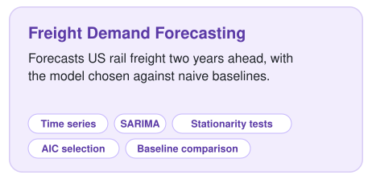
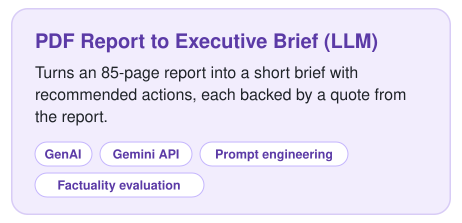
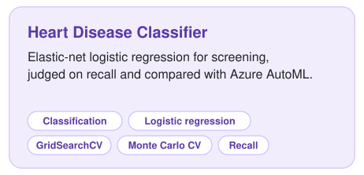
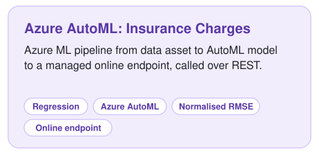

  

  
  
  
  

## About me

I'm a sustainability architect turned data scientist, and I love identifying problems and building technical solutions for them. The projects below are where I've done exactly that.

## Skills

  
  
  
  
  
  
  
  
  
  
  
  
  
  

## Featured projects

